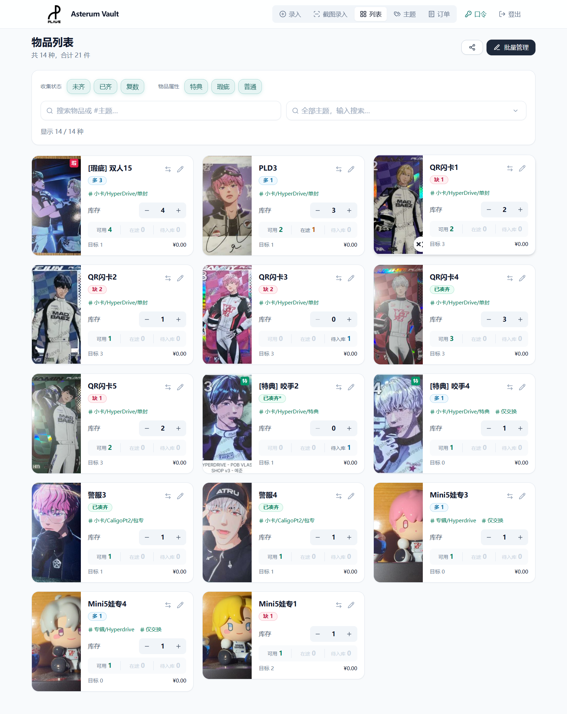
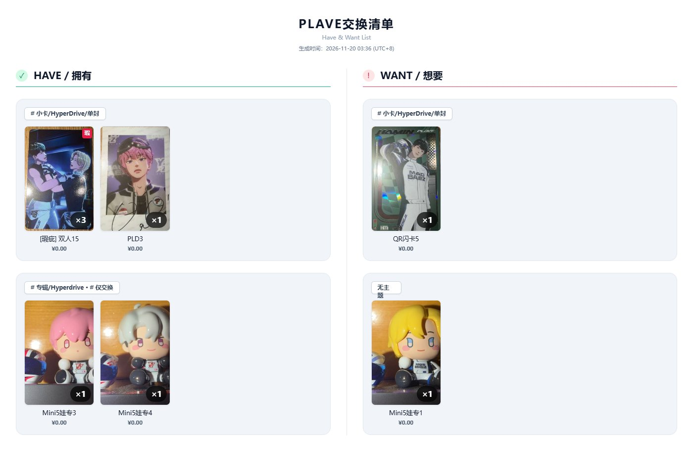

# Asterum Vault · PLAVE 周边与小卡收藏管理助手

专为 K-POP / PLAVE 周边、专辑小卡、特典卡收藏打造的个人库存与换卡流转管理工具。支持电脑端与手机端浏览器自适应访问，兼顾私密记账与对外换卡展示。

> ### 🌟 在线公开 Demo 体验站（欢迎自由试用）
 * **在线体验地址：**
>   * **主线路（国内免代理直连）：** [https://asterum-vault-demo.pages.dev/](https://asterum-vault-demo.pages.dev/)
>   * **备用线路（海外访问推荐）：** [https://asterum-vault-demo.vercel.app/](https://asterum-vault-demo.vercel.app/)
> * **访客视角免密直达链接：** [https://asterum-vault-demo.pages.dev/?code=plavedemo](https://asterum-vault-demo.pages.dev/?code=plavedemo)（若口令未被修改，点击即可直接进入访客页面；手动输入初始访客口令 **`plavedemo`** 亦可进入）
> * **管理员视角体验账号：**
>   * **登录邮箱：** `asterumvault@plave.com`
>   * **登录密码：** `0312Plave.0619`
> * *(温馨提示：Demo 站为公开共享测试环境，请勿上传个人隐私信息；体验管理员后台时请勿随意修改测试账号密码、访客口令。)*

---

## 界面预览

<table>
  <tr>
    <td align="center" width="50%">
      
      <br />
      <sub><b>物品列表与库存管理</b>（多维完备度追踪与快速筛选）</sub>
    </td>
    <td align="center" width="50%">
      
      <br />
      <sub><b>一键生成换卡海报</b>（筛选结果自动生成海报，可自定义隐藏部分结果）</sub>
    </td>
  </tr>
</table>


---

## 一、 核心功能亮点

### 1. 管理员视角（全功能库存与交易管理）

* **多种便捷录入方式：** 支持单张卡片精细录入（支持手机直接拍照上传）、多选图片批量导入，以及**截图智能识别裁切**（不仅支持自动解析 PLLI 在 `://weareplave.com` 生成的交换清单图，也**支持直接导入本助手生成的换卡海报原图或微信转发截图**一键拆卡入库，上传前自动压缩省流量）。
* **多维完备度自动追踪：** 设置每张卡的「目标持有数量」后，系统自动结合现货与在途订单计算状态：
  * **缺 X（红标）：** 尚未凑齐目标数量。
  * **已凑齐\*（绿标带星号）：** 账面总数已达标，但仍有约换中的交易未最终落地。
  * **已凑齐（绿标）：** 现货已彻底落袋集齐。
  * **多 X（蓝标）：** 超出目标数量，可直接用于换出或出售。
* **斜杠层级主题管理：** 支持用斜杠创建多级分类（例如 `专辑/出道专`、`特典/Ktown4u`），支持自定义排序权重与单卡最多 3 个标签关联；**录卡或编辑时可直接在标签选择框内输入新主题名称并现场创建、自动选中**，无需跳转管理页。
* **原子化换卡订单流转：** 创建「约换中」订单时自动锁定对应卡片的可用库存，防止超卖/超换；交易完成后一键扣除流出库存、增加流入库存；取消订单自动释放锁定数量，且表单草稿自动本地防丢。
* **一键生成高清换卡海报：** 自动提取「多出（HAVE）」与「缺少（WANT）」卡片生成双栏换卡图，内置**北京东八区（UTC+8）精确生成时间戳**、支持手动调整主题排序与勾选剔除单卡，提供高清 JPEG 下载及纯净截图模式。
* **访客口令与专属免密链接：** 支持在线随时修改或关闭访客口令，一键复制带暗号的专属分享链接（如 `https://你的域名/?code=暗号`），买家点开链接即可免输密码直接浏览，且地址栏自动抹除暗号防截图扩散。部署后初始访客口令默认为 `plave2026`，后期可自定义修改。
* **支持添加到桌面（PWA 轻量应用体验）：** 无需下载安装传统 App，在手机（Safari / Chrome 浏览器点击「分享 -> 添加到主屏幕」）或电脑浏览器地址栏点击「安装/添加到桌面」，即可在桌面生成独立应用图标，全屏沉浸式打开管理卡册，操作体验媲美原生 App。

### 2. 访客 / 换卡对象视角（安全只读模式）

* **零门槛浏览：** 拿到专属分享链接直接点开即可进入只读清单（若仅拿到主域名，输入管理员提供的访客口令即可进入）。
* **实时筛选与导出：** 可按名称、`#主题`、收藏状态及「多余/缺卡」条件快速筛选，并支持自行导出换卡参考图。
* **严格隐私隔离：** 访客模式下数据库列级自动隔离并隐藏管理员的卡片私密备注、订单备注及历史交易对象信息，且无任何修改权限（提示：收纳位置字段对访客可见，请勿在「收纳位置」中填写敏感个人地址）。

---

## 二、 零成本个人免费部署指南（零代码基础保姆级教程）

本项目采用纯前端静态架构（Vite 7 + React 18 + TypeScript + Tailwind CSS 3）搭配免费云数据库（Supabase）与免费网页托管（Cloudflare Pages），**全程无需下载编程软件、无需购买服务器或域名，个人使用 0 费用**。

### 第 1 步：准备代码仓库

1. 打开 [GitHub](https://github.com) 注册并登录账号。
2. 回到本仓库页面，点击右上角的 **Fork** 按钮（默认设置直接点 **Create fork**），将代码复制到你自己的 GitHub 账号下。

### 第 2 步：免费创建 Supabase 数据库并一键建表

1. 前往 [Supabase](https://supabase.com) 注册账号并点击 **New Project** 新建一个免费项目：
   * **Name：** 任意填写英文项目名（如 `asterum-vault`）。
   * **Database Password：** 自己设置并记牢数据库密码。
   * **Region：** 建议选择离你较近的 `Singapore`（新加坡）或 `Tokyo`（东京）。
   * **Data Access（关键）：** 保持默认**只勾选第一项** `Enable Data API`，下面两项安全选项**不要勾选**，点击 **Create new project** 等待约 1 分钟初始化完成。
2. **一键自动建表：**
   * 进入项目后台左侧菜单的 **SQL Editor -> New query**。
   * 打开你刚才 Fork 的 GitHub 仓库里的 `supabase/full_schema.sql` 文件，全选复制全部代码粘贴进编辑框，点击右下角绿色 **Run** 运行。
   * *(防呆提示)*：如果弹出黄色的风险提示框，不用慌张，直接点击黄色的 `Run without RLS` 即可；看到下方显示绿色的 `Success. No rows returned` 即表示全部数据表、权限隔离策略与 `card-images` 图片存储桶已自动建好。
3. **设置你的管理员账号：**
   * **关闭公开注册与邮箱验证：** 前往左侧 **Authentication -> Providers -> Email**，**取消勾选**以下两项并点击 **Save** 保存：
     * 关闭 `Allow new users to sign up`：禁止陌生人自行注册账号，保障数据安全。
     * 关闭 `Confirm email`：跳过邮件激活验证，支持直接用虚拟邮箱（如 `admin@plave.com`）当登录账号。
   * **创建管理员用户：** 前往左侧 **Authentication -> Users -> Add user -> Create new user**，输入你的管理员邮箱和密码（邮箱不需要真实存在，建议全小写），**务必勾选** `Auto Confirm User` 并点击创建。
   * **授予管理员白名单权限：** 回到左侧 **SQL Editor -> New query**，粘贴并运行以下语句（将单引号里的邮箱替换为你刚创建的邮箱）：
     ```sql
     INSERT INTO public.app_owners (user_id)
     SELECT id FROM auth.users WHERE email = '你的管理员邮箱@example.com';
     ```
4. **复制两把数据库连接钥匙：**
   * **获取 `Project URL`：** 点击左下角 **Project Settings（齿轮图标）-> Data API**（或 **General**），复制顶部的项目网址（格式严格为 `https://[系统生成].supabase.co`，**注意末尾不要包含 `/rest/v1` 后缀**）。
   * **获取 `anon public` key：** 点击左侧 **Project Settings -> API Keys**，点击页面右上方的 **`View legacy API keys`** 按钮（**不要复制主页默认的 `sb_publishable_` 密钥**），复制 **`anon` `public`** 一栏中以 **`eyJ`** 开头的长密钥。

### 第 3 步：一键部署上线到 Cloudflare Pages（推荐，大陆可直连）

1. **进入 Pages 创建页：** 注册并登录 [Cloudflare](https://cloudflare.com)，点击左侧菜单 **Compute -> Workers & Pages** -> 点击蓝色按钮 **Create application** -> **务必点击页面最底部的小字链接 `Continue to Pages`**（切勿误用默认的 Workers 模式）。
2. **关联 GitHub 仓库：** 点击 **Connect to Git**，授权并登录你的 GitHub 账号，选中你刚才 Fork 的仓库并点击 **Begin setup**。
3. **配置框架与环境变量（注意不要填反名称和值）：**
   * **Framework preset（框架预设）：** 下拉选择 **`React (Vite)`**（系统会自动填好构建命令 `npm run build` 与输出目录 `dist`）。
   * 展开下方的 **Environment variables (advanced)**，点击 **+ Add variable** 添加以下两组变量：
     * **第 1 组：**
       * `Variable name` 填：`VITE_SUPABASE_URL`
       * `Value` 填：第 2.4 步复制的 `https://[系统生成].supabase.co`（不含 `/rest/v1`）
     * **第 2 组：**
       * `Variable name` 填：`VITE_SUPABASE_ANON_KEY`
       * `Value` 填：第 2.4 步复制的 `eyJ` 开头的长密钥
4. **完成部署与访问：** 点击右下角蓝色按钮 **Save and Deploy**，等待约 1 分钟部署完成即可获得专属免费网址（`https://你的项目名.pages.dev`），国内手机与宽带可直接访问。
   * **进阶域名与大陆极速访问建议：** 免费二级域名在极端网络波动下仍可能受限；若希望获得中国大陆境内最稳定、最快速的访问体验，建议自行注册独立域名并完成 **ICP 备案** 后，绑定至国内正规静态托管 / CDN 服务（或绑定自有域名至 Cloudflare Pages **Custom domains**），即可彻底规避公共二级域名的连接波动。
5. **首次登录与改密：** 打开生成的网站，选择「管理员登入」，输入第 2.3 步创建的邮箱和密码即可开始录入小卡（初始默认访客口令为 `plave2026`，登录后请第一时间点击顶部「口令」按钮修改为你自己的专属暗号）。

> **备用部署方案（Vercel）及局限说明：**
> 你也可以将同一 GitHub 仓库部署至 [Vercel](https://vercel.com)（导入仓库 -> 展开 **Environment Variables** 填入上述同样的 `VITE_SUPABASE_URL` 与 `VITE_SUPABASE_ANON_KEY` -> 忽略可选插件直接点击 **Deploy**）。Vercel 打包速度极快、适合海外访问或开发预览，**但局限在于其免费赠送的 `*.vercel.app` 二级域名在中国大陆境内通常无法直接访问（需绑定自定义域名或使用网络代理）**，因此面向国内同好分享时建议优先使用 Cloudflare Pages。

### 第 4 步（可选）：开启全自动防休眠保活，彻底告别 7 天无访问暂停

Supabase 免费版在连续 **7 天**没有任何数据库请求时会自动进入休眠（Paused）状态。本项目已内置 GitHub Actions 定时唤醒脚本（每 5 天自动发送一次极轻量只读查询），只需在你的 GitHub 仓库配置两个密钥即可实现永久全自动保活：

1. **添加仓库密钥：** 打开你自己 Fork 的 GitHub 仓库页面，点击顶部 **`Settings`（设置）** -> 左侧菜单最底部的 **`Secrets and variables`** -> **`Actions`**。
2. **填入两组参数：** 点击绿色的 **`New repository secret`**，依次新增以下两个密钥（值与第 2.4 步复制的完全相同）：
   * **第 1 个：** `Name` 填 `SUPABASE_URL`，`Secret` 填你的 Supabase 项目地址（不带末尾斜杠）。
   * **第 2 个：** `Name` 填 `SUPABASE_ANON_KEY`，`Secet` 填你的 `eyJ` 开头的 `anon` public key。
3. **手动测试唤醒：** 配置完成后，点开仓库顶部的 **`Actionsr`** 标签页，左侧选中 **`Supabase 定时防休眠保活`** 并点击右侧 **`Run workflow`** 手动运行一次，看到出现绿色对勾即代表全自动保活已正式生效。

---

## 三、 日常维护小贴士

* **防休眠提醒：** Supabase 免费版数据库如果连续 **7 天**没有任何访问记录，会自动进入休眠（Paused）状态（数据不会丢失）。推荐按上方 **第 4 步** 配置好 GitHub Actions 自动保活，或每周至少打开一次网站浏览；若已休眠，只需在 Supabase 后台点击 `Restore project` 即可恢复活跃。
* **定期数据备份建议：** 建议定期在 Supabase 后台的 **Table Editor** 中将 `cards` 和 `orders` 数据表导出为 CSV 文件本地备份，或直接使用前端生成高清换卡海报留底，防止误操作导致收藏记录丢失。
* **大陆访问优化提示：** 默认提供的海外免费二级域名适合零成本快速体验；如长期面向国内同好分享并追求极致秒开体验，推荐自行申请独立域名、完成大陆 **ICP 备案** 并接入国内合规云服务商的静态网站托管与 CDN 加速。
* **如何获取后续版本更新（同步上游代码）：** 由于 Fork 仓库为独立副本，如果本仓库后续发布新功能或修复问题，你的 Fork 并不会自动接收最新代码。如需更新，只需打开你自己的 GitHub 仓库主页，点击代码列表上方的 **`Sync fork` -> `Update branch`** 按钮即可一键同步最新代码，随后你的 Cloudflare Pages / Vercel 网站会在约 1 分钟内自动重新部署更新（现有数据库中的卡片与订单数据完全保留不受影响）。

---

## 四、 二次开发、开源协议与免责声明

* **自由二开：** 本项目采用标准的 Vite 7 + React 18 + TypeScript + Tailwind CSS 3 + Supabase 纯前端架构，工程目录清晰，且已提供完整的系统架构说明（见 [`ARCHITECTURE.md`](./ARCHITECTURE.md)）以及数据库表结构与权限策略脚本（见 [`supabase/full_schema.sql`](./supabase/full_schema.sql)）。有开发经验的同担可直接 Fork 仓库在本地配置 `.env` 自由修改与二开，随心定制专属功能。
* **非官方与版权声明：** 本项目为粉丝（PLLI）自制的开源工具软件，与 VLAST 及 PLAVE 官方无任何关联。仓库代码及 Demo 站仅提供空壳框架与功能演示；用户自行部署后上传的所有图片与数据均由部署者个人存储于其私有数据库中，版权归原权利人所有。
* **AI 辅助声明与开源协议（MIT License）：** 本项目代码与架构在 AI 工具辅助下完成设计与生成，基于 **MIT License** 开源，按“原样”提供，免费供各位 PLLI 部署自用或二次开发，请勿用于商业倒卖。
### 交流与共建说明
* **部署与使用答疑**：个人业余时间用爱发电维护，精力有限，**暂不提供一对一远程代部署或手把手答疑服务**。部署遇到问题请优先核对本文档的自查清单；若发现文档遗漏或代码 Bug，欢迎在仓库的 **Issues** 区按模板反馈，我会抽空统一补充到文档中。
* **欢迎共同完善**：非常欢迎会前端或 Supabase 的同担通过 **Pull Request（PR）** 一起贡献新功能、优化移动端体验或补充常见问题解答。
